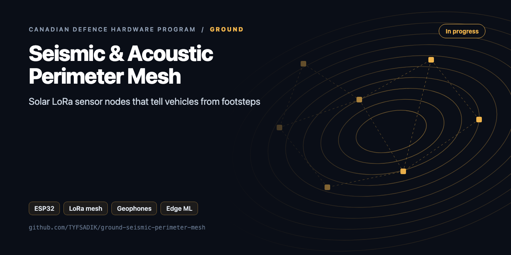
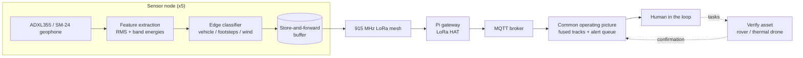

<div align="center">



# Ground: Seismic & Acoustic Perimeter Mesh

**Solar-powered 915 MHz LoRa mesh of ESP32 sensor nodes with ADXL355 accelerometers and geophones, classifying vehicles, footsteps, and wind at the edge.**

[](https://github.com/TYFSADIK/ground-seismic-perimeter-mesh/actions/workflows/tests.yml)   [](LICENSE) [](https://github.com/TYFSADIK/defence-hardware-program)

[Build guide](docs/project-page.md) · [How it works](#how-it-works) · [Quick start](#quick-start) · [Program hub](https://github.com/TYFSADIK/defence-hardware-program)

</div>

## Overview

This build is the **land component of the layered domain-awareness picture** Canada is assembling in the Arctic. The Canadian Arctic Sensor Suite Initiative aims at persistent surveillance from seabed to space, and the ground layer of that picture is a network of unattended sensors that stay alive for months in harsh conditions and report only what matters. DRDC's Northern Watch demonstration already showed where these systems hurt: not the sensors themselves, but installation, ice, technical failures, and **data management**.

My mesh is five ESP32 LoRa nodes spread across land I control. Each node reads a seismic sensor, classifies what it feels (vehicle, footsteps, or wind) **on the device**, and sends only a short signed detection message over the 915 MHz mesh to a Raspberry Pi gateway. Raw waveforms never leave the node, there is no bandwidth for them, and no need. When the gateway is unreachable, nodes buffer and sync later, which is the same store-and-forward discipline the rest of my defence program runs on.

The reason this belongs in a DevOps engineer's portfolio: keeping cheap nodes alive through a Canadian winter, buffering through dead links, signing their output, and fusing them into one trustworthy picture is an infrastructure problem wearing a hardware costume. That is the layer I build.

## How it works



*Each node senses, classifies, and buffers locally; only signed detections cross the mesh to the gateway and the common operating picture, where a human tasks a verify asset.*

## Quick start

```bash
make test     # C++ host tests (synthetic vehicle, footsteps, wind, quiet) + Python, including a C++→Python signed-packet cross-check
cp firmware/include_node_secrets.example.h firmware/src/node_secrets.h   # set NODE_ID + key
make flash
```

## What's in this repo

| Path | Language | Purpose |
|---|---|---|
| `firmware/lib/seismic/fft.h` | C++17 | Radix-2 FFT (1024 points) |
| `firmware/lib/seismic/seismic_features.h` | C++17 | 1 kHz × 1024 window → RMS, 3 band fractions (2-20, 20-60, 60-200 Hz), kurtosis, **footstep cadence** (envelope autocorrelation over about 4 s, 1.4-2.6 steps/s) |
| `firmware/lib/seismic/classifier.h` | C++17 | Explainable rules: every decision carries the rule that fired. Vehicles need sustained low-band energy across windows |
| `firmware/lib/seismic/sha256.h` | C++17 | SHA-256 and HMAC-SHA256 (RFC 4231 verified) |
| `firmware/lib/seismic/mesh.h` | C++17 | 29-byte packet, truncated HMAC tag (relays can decrement hops without breaking it), flooding with (src, seq) dedup, store-and-forward ring for gateway outages (T6) |
| `firmware/src/main.cpp` | Arduino | ADXL355 SPI at 1 kHz on a hardware timer, SX1262 radio (RadioLib) |
| `gateway/decode.py` | Python | Decodes and verifies packets, dedupes floods |
| `gateway/tune.py` | Python | Grid-searches thresholds on labelled feature logs for macro-F1, ready to paste into firmware |

## What you need

| Category | Item | Notes |
|----|----|----|
| Hardware | ESP32 nodes with LoRa | Heltec V3-class boards (ESP32 + SX1262), one per node, 915 MHz whips; never power the radio without the antenna attached |
| Hardware | Seismic front end | ADXL355 breakout on SPI, SM-24 geophone with low-noise preamp and ADS1256 ADC, twisted shielded pairs |
| Hardware | Acoustic channel | Analog MEMS microphone (MAX9814-class) into the ESP32 ADC, envelope-level sampling for machinery signatures |
| Hardware | Power | 18650 cells in protected holders, charge board, solar panel sized for winter sun, bulk capacitor on the rail |
| Hardware | Gateway | Raspberry Pi with LoRa HAT, MQTT broker on localhost |
| Software | ESP32 toolchain, RadioLib | Node firmware, flood mesh with (src, seq) dedup cache and hop limit |
| Software | Mosquitto, TFLite Micro (later) | Local broker now, tiny on-device ML classifier once the labelled dataset is big enough |
| Skills | Embedded C, SPI debugging, RF link basics | MODE0 discipline, bus ringing on long leads, RSSI/SNR interpretation, soldering |
| Accounts | None | No accounts or licenses required for a LoRa sensor mesh on 915 MHz |

## Status

- **Done**: all hardware purchased and on the bench; node v2.1 assembled with geophones and microphone staged; two-node 915 MHz range survey completed; MQTT topic and dashboard wired so bench detections render as tracks; SPI front end self-checking at boot.
- **In progress**: threshold-based classifier tuning on labelled walks and drive-bys; feature-extraction firmware (RMS + band energies) on the ADXL355 front end; store-and-forward buffer testing with deliberate gateway outages; noise-floor logging runs.
- **Next**: SM-24 geophone swap on two nodes with a measured detection-range comparison; tiny ML classifier (TFLite Micro) once the labelled dataset is big enough; multi-node outdoor deployment on solar; publishing the labelled dataset and the confusion-matrix results.

| Metric | Target | Measured to date | Current status |
|----|----|----|----|
| Sampling integrity (T1) | No dropped samples at 1 kHz sustained | No results published yet | In progress, long-run logging under way |
| Vehicle vs footsteps separation (T2/T3) | High, verified on the labelled confusion matrix | No results published yet | In progress, labelled dataset still growing |
| Wind false alarms (T4) | Driven toward zero per node per day | No results published yet | In progress, waiting on more windy-day captures |
| Mesh delivery ratio (T5) | High per-hop delivery at the surveyed spacing | No results published yet | In progress, range survey data collected, mesh runs pending |
| Outage recovery (T6) | Complete, ordered, deduped replay (at-least-once delivery, effectively-once processing after dedup) | No results published yet | In progress, buffer firmware in bench testing |
| Solar endurance (T7) | Survive a multi-day overcast stretch unattended | No results published yet | Pending, outdoor deployment not yet started |

## Roadmap

- [ ] Measure the quiet-night RMS per node and set `noise_gate_rms` to about 3× that
- [ ] Log features (not decisions) for labelled walks and drive-bys, then run `gateway/tune.py`
- [ ] Geophone channel: SM-24 → ADS1115/ADS1256 differential ADC, fused with the MEMS channel for long-range vehicles
- [ ] Second-pass model: a tiny MLP on the same feature vector (TFLite Micro), keeping the rules as a fallback
- [ ] Multi-node localisation: arrival-time differences between neighbouring nodes
- [ ] Deep sleep between windows when RMS stays below the gate for N minutes (solar budget)

## Related builds

- [**Multi-Domain Common Operating Picture**](https://github.com/TYFSADIK/multi-domain-common-operating-picture), where every signed detection from this mesh lands and fuses with air and water tracks.
- [**GPS-Denied Navigation Rover**](https://github.com/TYFSADIK/gps-denied-navigation-rover), the ground verify asset a human can task when this mesh raises a detection.
- [**Convoy-Following Robots on a Degraded Mesh**](https://github.com/TYFSADIK/rover-drive-stack), shares the LoRa mesh and store-and-forward-through-dead-links discipline.
- [**Canadian Defence Hardware Program**](https://github.com/TYFSADIK/defence-hardware-program), the program hub with the full build list and phased BOM.

## Learn more

The full build guide, with step-by-step instructions, wiring, troubleshooting and lessons learned, is in [docs/project-page.md](docs/project-page.md). It is also published at [tyfsadik.org](https://tyfsadik.org/work/defence/ground-seismic-perimeter-mesh.html).

## License

[MIT](LICENSE). Built by [Taki Sadik](https://tyfsadik.org) as part of the self-funded [Canadian Defence Hardware Program](https://github.com/TYFSADIK/defence-hardware-program).
