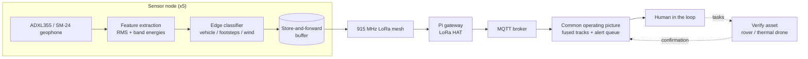
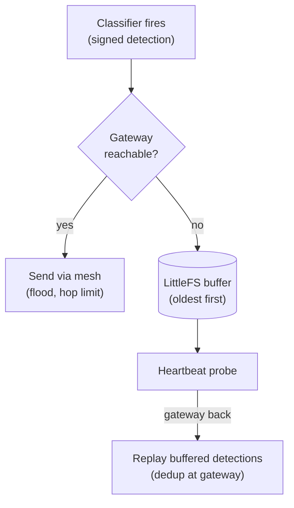

# Ground: Seismic & Acoustic Perimeter Mesh

Written by [Taki Sadik](https://tyfsadik.org/about.html) · Last updated 2026-10-22 · Status: Building · 29 min read

Solar-powered 915 MHz LoRa mesh of ESP32 sensor nodes with ADXL355 accelerometers (and an SM-24 geophone upgrade path) that classify vehicles vs footsteps vs wind at the edge and report signed detections to a common operating picture.

## Overview

This build is the **land component of the layered domain-awareness picture** Canada is assembling in the Arctic. The Canadian Arctic Sensor Suite Initiative aims at persistent surveillance from seabed to space, and the ground layer of that picture is a network of unattended sensors that stay alive for months in harsh conditions and report only what matters. DRDC's Northern Watch demonstration already showed where these systems hurt: not the sensors themselves, but installation, ice, technical failures, and **data management**.

My mesh is five ESP32 LoRa nodes spread across land I control. Each node reads a seismic sensor, classifies what it feels (vehicle, footsteps, or wind) **on the device**, and sends only a short signed detection message over the 915 MHz mesh to a Raspberry Pi gateway. Raw waveforms never leave the node, there is no bandwidth for them, and no need. When the gateway is unreachable, nodes buffer and sync later, which is the same store-and-forward discipline the rest of my defence program runs on.

The reason this belongs in a DevOps engineer's portfolio: keeping cheap nodes alive through a Canadian winter, buffering through dead links, signing their output, and fusing them into one trustworthy picture is an infrastructure problem wearing a hardware costume. That is the layer I build.

## Bill of Materials

| Part | Role | Details | Est. US\$ |
|----|----|----|----|
| Node boards | Mesh radio node | 5 ESP32 LoRa boards, 915 MHz (Heltec V3 / LilyGO T-Beam class) | 20-40 each |
| Sensors | On-node seismic sensing | 4 ADXL355-class accelerometer breakouts, SPI (four of five nodes; one more needed for one-per-node coverage) | 15-40 each |
| Upgrade (optional) | Long-range vehicle pickup | 3 SM-24 geophones + precision ADC | 100-180 |
| Node power | Unattended field power | 18650 cells, protected holders, small solar panel, charge board, weatherproof box | 25-40 each |
| Gateway | Mesh sink and dashboard link | LoRa HAT / gateway board for a Pi | 40-80 |

All of it is already bought and on the bench. The 915 MHz detail matters: that is the North American ISM band, 868 MHz LoRa parts are for Europe and are not legal to transmit on here.

## Architecture

Figure 1: each node senses, classifies, and buffers locally; only signed detections cross the mesh to the gateway and the common operating picture, where a human tasks a verify asset.

The design rule is that the mesh carries **detections, not data**. A signed JSON detection (node id, timestamp, class, confidence, feature summary) is a few dozen bytes, small enough to stay well inside the 902-928 MHz band's power and channel-occupancy rules (the applicable standard is ISED RSS-247 for digital transmission systems in 902-928 MHz, whose ceiling is 1 W conducted / 4 W EIRP with a compliant antenna; real compliance depends on the certified module's conditions, antenna gain, occupied bandwidth, and spectral density, and the nodes run at a modest TX power pinned in firmware, not at the regulatory ceiling, with channel dwell rules rather than a European-style duty-cycle percentage), small enough to buffer hundreds of on a node during a gateway outage, and small enough to sign on an ESP32 without breaking the power budget.

## Geophone versus Accelerometer: Why Both Exist Here

The SM-24 is a **moving-coil velocity sensor**, not a smaller accelerometer. A mass on a spring hangs inside a coil; ground motion moves the case while the mass stays put, and the relative velocity induces a voltage. Its natural frequency is 10 Hz, its open-circuit sensitivity is 28.8 V per m/s (20.9 V per m/s with a 1000 ohm shunt), and the coil measures 375 ohm. That means real vehicle ground roll arrives as millivolt-class signal: strong enough to hear far, but only through a low-noise preamp and a 24-bit ADC. It mounts vertical (tolerance 10 degrees of tilt) and survives minus 40 to plus 100 C, which is exactly the Canadian field envelope.

The ADXL355 is a **digital MEMS accelerometer**: it measures acceleration, not velocity, with a noise density around 22.5 to 25 micro-g per root hertz, and it talks SPI straight into the ESP32 with no analog chain at all. It is cheap, tiny, and nearly free in power, but its noise floor at seismic frequencies is far above a geophone's. The build uses the MEMS part for the always-on node (footsteps and nearby vehicles) and keeps the three SM-24 geophones as the sensitivity upgrade for vehicle signatures at ranges the MEMS part cannot touch.

**Figure:** the spectral band plan the edge classifier works from (engineering estimate, not measured spectra). The dashed line marks the SM-24's 10 Hz natural frequency, where the geophone is most sensitive. Measured spectra land on this page when the labelled runs are complete.

## Wiring & Connections

One node is a small system: sensor front end, radio, and power all meet on the ESP32. This is the full connection map for node v2.1 and the gateway.

| From | To | Cable or interface | Notes |
|----|----|----|----|
| ADXL355 breakout | ESP32 (Heltec V3) GPIO | SPI: SCK, MISO, MOSI, CS, plus 3V3 and GND on short twisted pairs | SPI MODE0 only; keep leads under ~15 cm or the bus rings at speed |
| SM-24 geophone | Low-noise preamp, then ADS1256 ADC | Twisted shielded pair | Vertical orientation; shield grounded at one end only |
| ADS1256 | ESP32 | Shared SPI bus, second CS line, DRDY to an interrupt-capable GPIO | Shares SCK/MISO/MOSI with the ADXL355; separate chip-selects |
| Analog MEMS microphone (MAX9814-class) | ESP32 ADC GPIO | Shielded 3-wire (VCC, GND, OUT) | Envelope-level sampling only, machinery signatures, not speech |
| SX1262 radio (on-board) | 915 MHz whip antenna | u.FL / SMA pigtail | Never key the transmitter without the antenna attached |
| Solar panel | Charge board input | 2-core 22 AWG through an IP65 gland | Panel outside the box, tilted for winter sun |
| 18650 cells in protected holders | Charge board B+/B- | 22 AWG | Protected cells or a fuse; triple-check polarity before first power |
| Charge board output | ESP32 5 V / VIN | 22 AWG | Bulk capacitor across the rail to ride out radio TX current spikes |
| Pi gateway | LoRa HAT | 40-pin GPIO header (SPI0) | Enable SPI via raspi-config; CE/reset pins follow the HAT's docs |
| Pi gateway | MQTT broker | localhost, broker runs on the same Pi | Listener bound to 127.0.0.1; the broker is never exposed to the LAN |

## How I Built It

Five nodes means flashing has to be boring and repeatable, so I drive everything from the command line: the Arduino-ESP32 core installed with `arduino-cli`, firmware compiled and uploaded the same way every time, and the SX1262 radio driven through the RadioLib library. The region is fixed at 915 MHz, the North American ISM band; 868 MHz hardware is for Europe and stays out of this build.

**Flash a heltec v3 node (macos)**

    # toolchain and board core
    arduino-cli core update-index
    arduino-cli core install esp32:esp32

    # build and upload over USB
    arduino-cli compile --fqbn esp32:esp32:heltec_wifi_lora_32_V3 firmware/node
    arduino-cli upload  --fqbn esp32:esp32:heltec_wifi_lora_32_V3 \
      --port /dev/cu.usbserial-0001 firmware/node

What can go wrong: a board that will not enumerate usually needs BOOT held during reset to enter the download stub. How I verified: `arduino-cli monitor` shows the boot banner and `radio.begin()` returning `RADIOLIB_ERR_NONE` on every board before it gets a node ID.

Before designing any mesh topology I wanted the honest hop distance, not the number on the datasheet. One node beacons from the bench at a fixed 10 dBm; I walk the second node down the street while the receiver logs RSSI and SNR for every decoded packet to a CSV over serial. That log is what decides node spacing later.

**Range sniffer, receiver core (radiolib)**

    // freq MHz, BW kHz, SF, CR, sync, power dBm, preamble, TCXO
    int state = radio.begin(915.0, 125.0, 9, 5, 18, 10, 8, 0);
    radio.startReceive();
    // in loop(), on DIO1 interrupt:
    int len = radio.getPacketLength();
    if (radio.readData(rx, len) == RADIOLIB_ERR_NONE) {
      Serial.printf("%lu,%s,%.0f,%.1f\n", millis(), rx,
                    radio.getRSSI(), radio.getSNR());
    }

**Capture the log**

    arduino-cli monitor -p /dev/cu.usbserial-0001 \
      --config baudrate=115200 > range-log.csv

What can go wrong: RSSI comparisons are meaningless if TX power or spreading factor changes between runs, so both are pinned in firmware. How I verified: I walk the same route twice at different times of day so I can sanity-check repeatability before trusting the map.

The ADXL355-class MEMS accelerometer rides on the SPI bus; the ADXL355 supports both SPI and I2C, but SPI is the wiring choice here because it avoids I2C pull-up noise at speed, and it streams the vertical (Z) axis at roughly 1 kHz. The enclosure base carries a spike that couples the sensor into the ground; coupling quality matters more than sensor price, a loose box is just a wind detector.

**Adxl355 self-check and stream setup**

    SPI.begin(SCK, MISO, MOSI, CS);
    SPI.beginTransaction(SPISettings(10000000, MSBFIRST, SPI_MODE0));

    uint8_t id = spiRead(0x00);          // DEVID register
    if (id != 0xAD) { Serial.println("ADXL355 not found"); while (true); }

    spiWrite(0x2C, 0x01);                // RANGE: +/- 2 g
    spiWrite(0x28, 0x02);                // FILTER: ODR 1000 Hz
    spiWrite(0x2D, 0x00);                // POWER_CTL: measurement mode
    // then burst-read XDATA3..ZDATA0 (0x08..0x10, 9 bytes) per sample

What can go wrong: reading all `0x00` or all `0xFF` means the wrong SPI mode or a CS wiring mistake, the 355 is strictly MODE0. How I verified: the DEVID self-check at boot, then a bench drop test watching the Z axis spike in the serial plotter at the expected polarity.

A 1 kHz stream is far too much to send over LoRa and too much to classify raw on a microcontroller, so each node windows 1024 samples (about one second) and compresses the window into a small feature vector: RMS amplitude plus the energy in three spectral bands from an FFT. The classifier downstream sees a handful of numbers per second, not a thousand samples.

**Window to rms + band energies (arduinofft)**

    static double vReal[1024], vImag[1024];   // static: no heap churn
    ArduinoFFT<double> FFT(vReal, vImag, 1024, 1000.0);

    double rms = 0;
    for (int i = 0; i < 1024; i++) { vReal[i] = z[i]; vImag[i] = 0; rms += z[i]*z[i]; }
    rms = sqrt(rms / 1024);

    FFT.dcRemoval();
    FFT.windowing(FFTWindow::Hamming, FFT_FORWARD);
    FFT.compute(FFT_FORWARD);
    FFT.complexToMagnitude();
    // sum bins into bands: 5-20 Hz (vehicle rumble),
    // 20-80 Hz (footstep energy), 80-250 Hz (broadband / wind)

What can go wrong: allocating those FFT buffers per window fragments the ESP32 heap within hours, they are static. How I verified: a host-side unit test feeds a synthetic 50 Hz sine through the same code path and confirms the energy lands in the expected band before I trust the on-device version.

First pass is explainable thresholds, because a rule I can read is a rule I can debug in the field: quiet gating on RMS, vehicles as sustained low-band-dominant energy that grows and fades as they pass, footsteps as a periodic cadence peak in a walking band, and everything else filed as wind or unknown. The second pass, once my labelled dataset is big enough, is a tiny model trained in Python and converted with TensorFlow Lite Micro (via Edge Impulse) running on the same feature vector.

**Threshold classifier, first pass**

    const char* classify(float rms, float bandLo, float bandMid, float dur) {
      if (rms < NOISE_FLOOR * 3.0f)             return "quiet";
      if (bandLo > 0.6f && dur > 2.0f)            return "vehicle";
      if (cadenceHz > 1.5f && cadenceHz < 2.5f)   return "footsteps";
      return "wind_or_unknown";
    }

**Embed the ml model when it ships**

    xxd -i model.tflite > model_data.h   # C array, compiled into firmware

What can go wrong: thresholds tuned on one node do not transfer, soil, mounting, and sensor variance all shift the noise floor, so each node runs a quiet-period calibration on install. How I verified: labelled recordings are replayed through the classifier on the host first; a firmware build only gets flashed if the replay matches the expected labels.

The mesh carries a small fixed-format packet: version, type, source node, hop counter, per-source sequence number, payload, and a CRC. Forwarding is controlled flooding over raw LoRa (this is application-level flooding, not LoRaWAN), every node that hears a packet retransmits it once, with the hop counter as the kill switch and a (src, seq) seen-cache as the dedup. Spreading factor 9 at 125 kHz bandwidth is my range-versus-airtime compromise for this spacing.

**Mesh packet format (firmware)**

    struct MeshPacket {
      uint8_t  version;      // 0x02
      uint8_t  type;         // 0x01 detection, 0x02 ack, 0x03 heartbeat
      uint8_t  src;          // node id 1-5
      uint8_t  hops;         // incremented per forward, dropped at 4
      uint32_t seq;          // per-source sequence; dedup key with src
      uint8_t  payload[180];
      uint16_t crc16;
    } __attribute__((packed));

What can go wrong: without the seen-cache, two forwarding nodes ping-pong the same packet forever; and simultaneous retransmits collide, so each node adds a randomized backoff keyed on its ID. How I verified: a three-node bench flood with the relay node powered off mid-test, confirming the remaining path still delivers and no packet loops.

Gateways reboot, links drop, and I will absolutely break the gateway while tinkering. When no ACK comes back, the node appends the signed detection to an append-only log in LittleFS and keeps sensing. On link restore it replays oldest-first, waiting for the gateway ACK before truncating each record, the same store-and-forward pattern as my [DDIL-proof DevOps](https://github.com/TYFSADIK/ddil-proof-devops) work, shrunk onto a microcontroller.

**Buffer and replay (littlefs)**

    if (!gatewayAcked) {
      File f = LittleFS.open("/queue.bin", FILE_APPEND);
      f.write((uint8_t*)&det, sizeof(det));
      f.close();
    }
    // on reconnect: read oldest record, retransmit,
    // wait for ACK(seq), then truncate. Repeat until empty.

What can go wrong: flash wears out and filesystems fill, the queue is capped, drop-oldest events are counted and reported in the heartbeat, and only detections are ever buffered, never raw waveforms. How I verified: pull the gateway's power for a set interval, generate detections, restart it, and confirm every sequence number arrives without loss and in order, with the (src, seq) dedup giving effectively-once processing after deduplication on repeats.

The gateway is a Raspberry Pi wearing a LoRa HAT on the 40-pin header. A small Python service decodes mesh packets, verifies the Ed25519 signature against a per-node public key table, drops replays via the (src, seq) dedup, and republishes clean detections to mosquitto, which listens on localhost only, so the broker is never exposed to the LAN.

**Gateway service (pynacl + paho-mqtt)**

    from nacl.signing import VerifyKey
    import paho.mqtt.client as mqtt

    def on_packet(pkt):
        det, sig = split_payload(pkt)
        if seen(det["src"], det["seq"]):
            return                                  # replay, drop
        VerifyKey(pubkeys[det["src"]]).verify(det_bytes, sig)  # raises on forgery
        mq.publish("perimeter/ground/detections", json.dumps(det), qos=1)

**Broker config, localhost only**

    # /etc/mosquitto/conf.d/perimeter.conf
    listener 1883 127.0.0.1
    allow_anonymous true

What can go wrong: every HAT wires CE and reset to different GPIOs, read the HAT's docs instead of assuming. How I verified: a negative test, I sign a packet with the wrong key and confirm the service rejects it and logs the attempt, because a verifier that never fails is a verifier that is not running.

Each node runs on 18650 cells in protected holders, topped up by a small solar panel through a charge board, inside a weatherproof box with IP65 glands for the sensor and panel leads. The power budget, not the sensor, decides whether a node survives a dark January week, so the firmware duty-cycles hard: wake, sample a one-second window, classify, transmit only if there is a detection, deep sleep again.

**Duty-cycle sleep (firmware)**

    // one sensing cycle done; radio off, sleep until next window
    esp_sleep_enable_timer_wakeup(4 * 1000000ULL);
    esp_deep_sleep_start();   // ESP32 chip deep sleep is microamp-class; the full board
                             // (regulator, USB-UART bridge, charge circuit) draws more, measure the board

What can go wrong: a radio TX burst can brown out a cold or tired cell mid-packet, hence the bulk capacitor across the rail, and the standing rule that a frozen Li-ion cell warms up before it ever sees charge current. How I verified: a multimeter in series over many full duty cycles, checking the measured average current matches the spreadsheet budget before the box gets sealed.

Every node owns an Ed25519 keypair; the private key never leaves the device. Each detection is serialized, signed on the node with libsodium's Ed25519 implementation (RFC 8032), and the gateway verifies before anything reaches the [common operating picture](https://github.com/TYFSADIK/multi-domain-common-operating-picture). A forged or corrupted message dies at the gateway, which is exactly where untrusted input should die. Note on library choice: Monocypher's default `crypto_eddsa_*` is a BLAKE2b-based EdDSA variant, not interoperable RFC 8032 Ed25519, so it would not verify against the PyNaCl gateway; libsodium's `crypto_sign_detached` is used instead, which the gateway verifies with PyNaCl.

**Detection message, what leaves the node**

    {
      "node": 2, "seq": 1187, "ts": 1758268800,
      "class": "vehicle", "conf": 0.91,
      "rms": 0.042, "bands": [0.61, 0.28, 0.11],
      "sig": "Ed25519 signature over the fields above, base64"
    }

**Sign on the node (libsodium, rfc 8032 ed25519)**

    crypto_sign_detached(sig, NULL, msg, msg_len, sk);   // detached Ed25519 signature; sk is the 64-byte libsodium secret key, verified on the gateway with PyNaCl

What can go wrong: key management is the weak point, private keys are generated per node and recorded offline, and a lost key means a reflash, not a recovery procedure. How I verified: flip one byte in a signed message and confirm the gateway rejects it; the negative test is the test that matters.

The three SM-24 geophones are the sensitivity upgrade: a true moving-coil geophone picks up vehicle signatures at ranges a MEMS accelerometer cannot touch. The SM-24 feeds a low-noise preamp and then an ADS1256-class 24-bit ADC, which shares the SPI bus with the ADXL355 on its own chip-select, so the feature pipeline and classifier carry over unchanged and only the front-end driver differs. The three labelled geophones on the bench are staged for exactly this swap.

**Sm-24 front end (ads1256, shared spi)**

    adc.begin(SCK, MISO, MOSI, CS_ADC, DRDY);
    adc.setPGA(PGA_16);            // geophone output is millivolt-class
    adc.setDRATE(DRATE_500SPS);    // plenty for a 10 Hz geophone

What can go wrong: mains hum swamps a high-gain geophone preamp on the bench, battery power and short twisted leads keep it quiet, and the geophone must sit vertical to read ground motion correctly. How I verified: side-by-side with the ADXL355 on the same spike, tapping the ground at a measured distance and comparing signal-to-noise between the two front ends.

A mesh detection does not trigger anything automatic, it lands in the alert queue of the common operating picture and waits for a human. I read the detection, and if it deserves eyes, I task the [GPS-denied rover](https://github.com/TYFSADIK/gps-denied-navigation-rover) or the [thermal SAR drone](https://github.com/TYFSADIK/thermal-sar-drone) to go look; the asset's confirmation flows back onto the dashboard as a track update. The human tasks, the machine ferries.

**Human tasking (operator console)**

    mosquitto_pub -h localhost -t "perimeter/tasking" -m \
      '{"asset":"rover","action":"goto","node":2,"reason":"detection seq=1187"}'

What can go wrong: automation creep, the tasking topic only accepts publishes from the operator console, never from the mesh or the gateway service, so no sensor output can task an asset by itself, ever. How I verified: attempted to publish a tasking message from the gateway's service account and confirmed it is rejected.

## The Edge-Classification Bargain

A node sampling at 1 kHz generates 1000 samples per second per axis; the FFT consumes them in 1024-sample (1.024 s) windows; over LoRa, sending that raw stream is impossible, it would take hours of airtime per minute of signal. The FFT band plan above is what makes the bargain work: one window of samples collapses into a handful of numbers (RMS plus the energy in each band), and the classifier decides vehicle, footsteps, wind, or unknown from those numbers alone. The feature vector, not the waveform, is all the mesh ever carries. That is why the classifier has to be explainable first: when a node reports a vehicle at 3 a.m., I want to read the rule that fired, not trust a black box I cannot debug in the field.

## Testing & Metrics

The protocol is built around labelled ground truth I generate myself, on land I control, with measured distances. Every run below has a defined setup, procedure, and metric; where a run is still collecting data, the status column says so. No results are published yet, only targets and methods.

### Test Runs

1.  **T1, Bench noise floor and sampling integrity.** Setup: node on the bench, ADXL355 streaming. Procedure: log raw windows and count dropped samples over long runs at the 1 kHz rate. Metric: zero dropped samples sustained, and a stable, low noise floor with nothing moving.
2.  **T2, Labelled footstep passes.** Setup: node spiked into the ground, routes marked at measured distances. Procedure: I walk each route a set number of times at a normal pace; each window is recorded with its true label. Metric: per-node confusion matrix for footsteps vs quiet vs wind.
3.  **T3, Vehicle drive-bys.** Setup: same node placement, my vehicle driven past at set distances and speeds. Procedure: repeated passes in both directions, logged with distance and direction. Metric: detection range curve, the distances at which the classifier fires reliably.
4.  **T4, Wind reject days.** Setup: node deployed on logged windy days with no deliberate activity. Procedure: long unattended captures. Metric: false-alarm rate per node per day, the number that must trend toward zero before I call the classifier done.
5.  **T5, Mesh range and delivery.** Setup: two nodes at the spacing chosen from the step-02 survey. Procedure: beacon exchanges logged at both ends. Metric: packet delivery ratio per hop with RSSI/SNR margins.
6.  **T6, Gateway outage and store-and-forward.** Setup: node live, gateway deliberately powered off for a set interval. Procedure: generate detections during the outage, restore the gateway, watch the replay. Metric: every buffered detection delivered without loss and in sequence order, with the dedup giving effectively-once processing after deduplication on repeats.
7.  **T7, Power endurance.** Setup: sealed node on solar, voltage and charge state logged continuously through real weather, including cold snaps. Metric: uptime through multi-day overcast stretches, and agreement between the measured average current and the power budget.

### Outage Replay Protocol (T6)

Figure 2: the T6 outage protocol. Detections either flood the mesh immediately or wait in the on-device buffer; on reconnect the node replays oldest-first and the gateway dedups, so the operator sees a gapless log.

### Targets, Measured Evidence, and Current Status

Evidence and targets are kept separate: the "measured to date" column holds only what has actually been recorded, and the target column holds what the build is aiming at.

| Metric | Target | Measured to date | Current status |
|----|----|----|----|
| Sampling integrity (T1) | No dropped samples at 1 kHz sustained | No results published yet | In progress, long-run logging under way |
| Vehicle vs footsteps separation (T2/T3) | High, verified on the labelled confusion matrix | No results published yet | In progress, labelled dataset still growing |
| Wind false alarms (T4) | Driven toward zero per node per day | No results published yet | In progress, waiting on more windy-day captures |
| Mesh delivery ratio (T5) | High per-hop delivery at the surveyed spacing | No results published yet | In progress, range survey data collected, mesh runs pending |
| Outage recovery (T6) | Complete, ordered, deduped replay (at-least-once delivery, effectively-once processing after dedup) | No results published yet | In progress, buffer firmware in bench testing |
| Solar endurance (T7) | Survive a multi-day overcast stretch unattended | No results published yet | Pending, outdoor deployment not yet started |

When the labelled runs are complete, the dataset and the confusion matrices land on this page. Until then, everything above is protocol and targets, not results.

## Troubleshooting & Lessons

- **Accelerometer reads all 0x00 or all 0xFF.** Classic SPI bring-up failure: the ADXL355 is strictly SPI MODE0, and one swapped CS or clock line produces exactly this. The fix is the boot-time DEVID self-check (expect `0xAD`), fail loudly at startup instead of silently logging garbage in the field.
- **Brownout resets when the radio transmits.** The TX current spike sagged the rail on a weak cell and reset the ESP32 mid-packet. Fixed with a bulk capacitor across the supply rail and by checking voltage under load, not at rest, a cell that reads fine on the bench can still collapse under a TX burst in the cold.
- **A "detector" that was really detecting its own enclosure.** Early wind false alarms traced to the box itself vibrating and coupling noise into the spike. Rigid mounting fixed most of it; the rest is why wind became its own labelled reject class instead of an afterthought.
- **Packet storms after adding forwarding.** The first mesh build had no dedup, and two forwarding nodes happily retransmitted each other's copies forever. The (src, seq) seen-cache plus the hop limit ended the storms; any flooding protocol needs both from day one.
- **Moisture in a "sealed" box.** Temperature swings pump moist air past a badly seated gland. Properly tightened IP65 glands plus a desiccant pack per box, and a lesson learned: weatherproofing is a system, not a product you buy.

## Legal, Safety & Canada Notes

**Radio rules:** the mesh transmits on 915 MHz, the North American ISM band, at LoRa-legal transmit power: the applicable standard is ISED RSS-247 for digital transmission systems in 902-928 MHz, whose ceiling is 1 W conducted / 4 W EIRP with a compliant antenna, and real compliance depends on the certified module's conditions, antenna gain, occupied bandwidth, and spectral density. The nodes run at a modest TX power pinned in firmware, not at the regulatory ceiling, with channel dwell rules rather than a European-style duty-cycle percentage. 868 MHz hardware is for Europe and is not used. Nothing in this build jams, spoofs, or interferes with anyone else's signals.

**Placement and privacy:** nodes run only on land I control and are never pointed at other people. The seismic and acoustic processing targets machinery and movement signatures: engine rumble, footstep cadence, not speech. Only short class labels and confidence values leave each node; raw waveforms stay on the device.

## Status & Roadmap

- **Done**: all hardware purchased and on the bench; node v2.1 assembled with geophones and microphone staged; two-node 915 MHz range survey completed; MQTT topic and dashboard wired so bench detections render as tracks; SPI front end self-checking at boot.
- **In progress**: threshold-based classifier tuning on labelled walks and drive-bys; feature-extraction firmware (RMS + band energies) on the ADXL355 front end; store-and-forward buffer testing with deliberate gateway outages; noise-floor logging runs.
- **Next**: SM-24 geophone swap on two nodes with a measured detection-range comparison; tiny ML classifier (TFLite Micro) once the labelled dataset is big enough; multi-node outdoor deployment on solar; publishing the labelled dataset and the confusion-matrix results.

## Related Builds

- [**Multi-Domain Common Operating Picture**](https://github.com/TYFSADIK/multi-domain-common-operating-picture), where every signed detection from this mesh lands and fuses with air and water tracks.
- [**GPS-Denied Navigation Rover**](https://github.com/TYFSADIK/gps-denied-navigation-rover), the ground verify asset a human can task when this mesh raises a detection.
- [**Convoy-Following Robots on a Degraded Mesh**](https://github.com/TYFSADIK/rover-drive-stack), shares the LoRa mesh and store-and-forward-through-dead-links discipline.
- [**Canadian Defence Hardware Program**](https://github.com/TYFSADIK/defence-hardware-program), the program hub with the full build list and phased BOM.

## Build Narrative: Phase by Phase

**Phase 1: node v2.1 assembly.** Each node is a small system on an ESP32 (Heltec V3): an ADXL355 accelerometer on SPI for the fast channel, an SM-24 geophone through a low-noise preamp into an ADS1256 ADC for the slow sensitive channel, and an analog MEMS microphone on the ADC for acoustic machinery signatures. The on-board SX1262 handles 915 MHz LoRa. A boot-time DEVID self-check expects 0xAD from the accelerometer so a dead sensor fails loudly at startup instead of logging garbage in the field.

**Phase 2: wiring discipline.** The full connection map was built once and then frozen: ADXL355 on SPI MODE0 with short twisted pairs, the ADS1256 sharing the SPI bus on a second chip-select with DRDY on an interrupt-capable GPIO, geophone leads as a shielded twisted pair grounded at one end only, and a bulk capacitor across the supply rail to ride out radio transmit current spikes.

**Phase 3: link survey.** A two-node 915 MHz range survey on land I control fixed the deployment spacing and confirmed packet delivery ratios with RSSI/SNR margins before any classifier work began. The radio link was characterized before it was depended on.

**Phase 4: gateway and dashboard.** A Raspberry Pi gateway with a LoRa HAT takes the mesh traffic and runs a local Mosquitto broker (bound to localhost, never exposed to the LAN) plus the MQTT topic and dashboard that renders bench detections as tracks.

**Phase 5: classifier and outage testing.** On-device classification (vehicle, footsteps, wind) runs on the node so raw waveforms never need the air; only short signed detection messages flood the mesh with a hop limit. The T6 store-and-forward test deliberately kills the gateway and replays the LittleFS buffer oldest-first with deduplication at the gateway, so the operator sees a gapless log after an outage.

## What You Need

Five nodes on land I control is the target deployment. The skill most people skip is link budgeting: the range survey comes before the classifier, not after.

| Category | Item | Notes |
|----|----|----|
| Hardware | ESP32 nodes with LoRa | Heltec V3-class boards (ESP32 + SX1262), one per node, 915 MHz whips; never power the radio without the antenna attached |
| Hardware | Seismic front end | ADXL355 breakout on SPI, SM-24 geophone with low-noise preamp and ADS1256 ADC, twisted shielded pairs |
| Hardware | Acoustic channel | Analog MEMS microphone (MAX9814-class) into the ESP32 ADC, envelope-level sampling for machinery signatures |
| Hardware | Power | 18650 cells in protected holders, charge board, solar panel sized for winter sun, bulk capacitor on the rail |
| Hardware | Gateway | Raspberry Pi with LoRa HAT, MQTT broker on localhost |
| Software | ESP32 toolchain, RadioLib | Node firmware, flood mesh with (src, seq) dedup cache and hop limit |
| Software | Mosquitto, TFLite Micro (later) | Local broker now, tiny on-device ML classifier once the labelled dataset is big enough |
| Skills | Embedded C, SPI debugging, RF link basics | MODE0 discipline, bus ringing on long leads, RSSI/SNR interpretation, soldering |
| Accounts | None | No accounts or licenses required for a LoRa sensor mesh on 915 MHz |

## Challenges and Lessons Learned

- **The ADXL355 read all 0x00 or all 0xFF.** Classic SPI bring-up failure from one swapped line. Lesson: the boot-time DEVID self-check is now non-negotiable, fail loudly at startup rather than logging plausible garbage.
- **Brownout resets when the radio transmitted.** TX current spikes collapsed a weak cell's voltage and reset the ESP32 mid-packet. Lesson: measure voltage under load, not at rest, and a bulk capacitor across the rail is cheap insurance.
- **The detector detected its own enclosure.** Early wind false alarms traced to the box vibrating and coupling noise into the geophone. Lesson: rigid mounting fixed most of it; wind became a labelled reject class of its own, which is why T4 wind-reject days exist.
- **Packet storms from flooding.** The first mesh had no dedup and two forwarding nodes retransmitted each other's copies forever. Lesson: any flooding protocol needs a (source, sequence) seen-cache plus a hop limit from day one.
- **Moisture in a sealed box.** Temperature swings pumped moist air past a badly seated gland. Lesson: weatherproofing is a system (tightened IP65 glands plus desiccant), not a product you buy.

## What Is Next

- SM-24 geophone swap on two nodes with a measured detection-range comparison against the accelerometer-only nodes.
- Tiny ML classifier (TFLite Micro) on the node once the labelled walk and drive-by dataset is large enough.
- Multi-node outdoor deployment on solar, with T7 power-endurance logging through real weather including cold snaps.
- Publish the labelled dataset and the confusion-matrix results: footsteps vs quiet vs wind, with the false-alarm rate per node per day trending toward zero before the classifier is called done.
- Feed signed detections from the field deployment into the multi-domain common operating picture alongside the other nodes.

## Frequently Asked Questions

Classic SPI bring-up failure: the ADXL355 is strictly SPI MODE0, and one swapped CS or clock line produces exactly this. The fix is the boot-time DEVID self-check (expect 0xAD), fail loudly at startup instead of silently logging garbage in the field.

The TX current spike sagged the rail on a weak cell and reset the ESP32 mid-packet. Fixed with a bulk capacitor across the supply rail and by checking voltage under load, not at rest, a cell that reads fine on the bench can still collapse under a TX burst in the cold.

Early wind false alarms traced to the box itself vibrating and coupling noise into the spike. Rigid mounting fixed most of it; the rest is why wind became its own labelled reject class instead of an afterthought.

The first mesh build had no dedup, and two forwarding nodes happily retransmitted each other's copies forever. The (src, seq) seen-cache plus the hop limit ended the storms; any flooding protocol needs both from day one.

Temperature swings pump moist air past a badly seated gland. Properly tightened IP65 glands plus a desiccant pack per box, and a lesson learned: weatherproofing is a system, not a product you buy.

## Cite This Page

**Plain text**

    Taki Sadik, "Ground: Seismic &amp; Acoustic Perimeter Mesh", TYFSADIK, https://github.com/TYFSADIK/ground-seismic-perimeter-mesh (accessed 2026-10-22).

**BibTeX**

    @misc{sadik-ground-seismic-perimeter-mesh,
      author  = {Sadik, MD. Taki Yasir Faraji},
      title   = {Ground: Seismic &amp; Acoustic Perimeter Mesh},
      year    = {2026},
      url     = {https://github.com/TYFSADIK/ground-seismic-perimeter-mesh},
      urldate = {2026-10-22}
    }

**APA**

    Sadik, M. T. Y. F. (2026). Ground: Seismic &amp; Acoustic Perimeter Mesh. TYFSADIK. https://github.com/TYFSADIK/ground-seismic-perimeter-mesh

---

Original page: <https://github.com/TYFSADIK/ground-seismic-perimeter-mesh>
